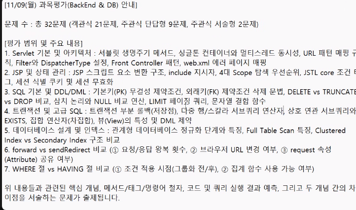
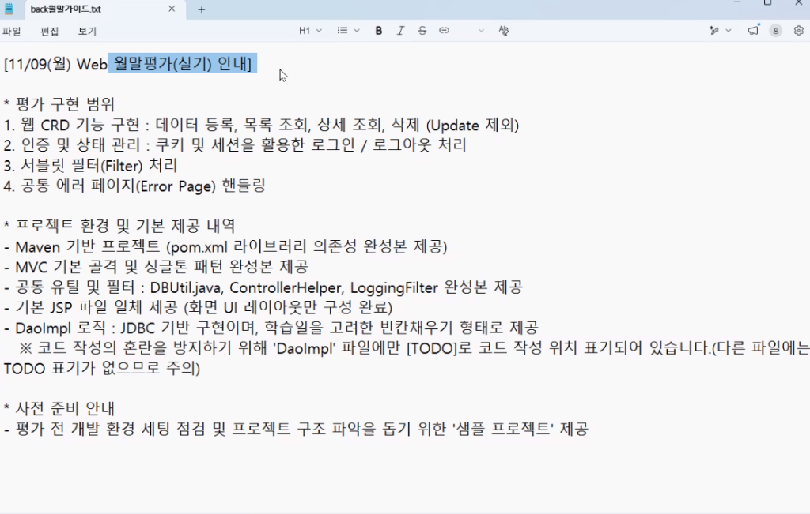

# 🎓 SSAFY 1학기 BackEnd & DB 과목평가 / Web 월말평가(실기) 완벽 대비 올인원 시스템

본 저장소는 **11/09(월) 실시되는 SSAFY 과목평가(이론 32제) 및 Web 월말평가(실기 CRD)**를 비전공자 및 초보자도 쉽게 이해하고 100점 만점으로 통과할 수 있도록 구축된 통합 학습 및 모의평가 시스템입니다.

---

## 🌐 1. 로컬 실시간 학습 사이트 접속 안내

현재 로컬 웹 서버(포트 8085)가 백그라운드로 실행 중이며, 브라우저를 통해 실전 모의고사와 실습 가이드를 즉시 이용하실 수 있습니다.

- **접속 URL**: [http://localhost:8085/WebTest_시험대비_학습웹.html](http://localhost:8085/WebTest_시험대비_학습웹.html)
- **로컬 파일 직접 열기**: [WebTest_시험대비_학습웹.html](file:///C:/Users/SSAFY/Desktop/JSP/WebTest_시험대비_학습웹.html)
- **서버 재실행 명령어** (필요 시):
  ```powershell
  python -m http.server 8085 --directory "C:\Users\SSAFY\Desktop\JSP"
  ```

---

## 📸 2. 공식 시험 안내 공지 캡처본 및 상세 분석

### [공지 1] 11/09(월) 과목평가 (BackEnd & DB 이론) 안내


#### 📝 이론 평가 구성 및 출제 기준
- **시험 구성**: **총 32문제 (100점 만점)**
  - **객관식 21문제** (각 2.5점 = 52.5점)
  - **주관식 단답형 9문제** (각 3.0점 = 27.0점)
  - **주관식 서술형 2문제** (각 10.25점 = 20.5점)
- **🌟 [완비] 10회분 풀 모의고사 (총 320문제) 탑재**:
  1. **제1회**: 전범위 기본 완성 모의평가
  2. **제2회**: 서블릿 아키텍처 & 생명주기 집중형
  3. **제3회**: JSP 스크립트 & 4대 Scope/상태관리 특화형
  4. **제4회**: SQL DDL/DML & 무결성 제약조건 마스터형
  5. **제5회**: 트랜잭션(ACID) & 고급 서브쿼리 정복형
  6. **제6회**: 데이터베이스 정규화(1NF~BCNF) & 인덱스 구조형
  7. **제7회**: 실전 기출유형 변형 & 빈출 함정 탈출형
  8. **제8회**: 심화 아키텍처 & 성능 최적화(FTS/Index)형
  9. **제9회**: 실전 시뮬레이션 파이널 A형
  10. **제10회**: 실전 시뮬레이션 파이널 B형 (만점 도전)
- **7대 핵심 평가 범위**:
  1. **Servlet 기본 및 아키텍처**: 서블릿 생명주기 메서드(`init`, `service`, `destroy`), 싱글톤 컨테이너와 멀티스레드 동시성, URL 패턴 매핑 규칙, Filter와 DispatcherType 설정(`FORWARD` 등), Front Controller 패턴, web.xml 에러 페이지 매핑
  2. **JSP 및 상태 관리**: JSP 스크립트 요소 변환 구조(`_jspService` 내부 지역변수), include 지시자 vs 액션 태그, 4대 Scope 탐색 우선순위(`page` ➔ `request` ➔ `session` ➔ `application`), JSTL core 조건 태그(`<c:choose>`), 세션 식별 쿠키(`JSESSIONID`) 및 세션 무효화(`invalidate()`)
  3. **SQL 기본 및 DDL/DML**: 기본키(PK) 무결성, 외래키(FK) 제약조건 삭제 문법(`ALTER TABLE ... DROP FOREIGN KEY`), DELETE vs TRUNCATE vs DROP 비교, 삼치 논리와 NULL 비교 연산(`NULL = NULL ➔ Unknown`), LIMIT 페이징 쿼리, 문자열 결합 함수(`CONCAT`)
  4. **트랜잭션 및 고급 SQL**: 트랜잭션 부분 롤백(`SAVEPOINT`), 다중 행/스칼라 서브쿼리 연산자(`ANY`, `ALL`, `IN`), 상호 연관 서브쿼리와 `EXISTS`, 집합 연산자(차집합 `EXCEPT`), 뷰(View)의 가상 테이블 특성 및 DML 제약
  5. **데이터베이스 설계 및 인덱스**: 관계형 DB 정규화 단계(1NF 원자값, 2NF 완전함수종속, 3NF 이행종속제거, BCNF 결정자=후보키), Full Table Scan 특징, Clustered Index vs Secondary Index 구조 비교
  6. **[서술형 1] forward vs sendRedirect 비교**: ① 요청/응답 왕복 횟수(1회 vs 2회), ② 브라우저 URL 변경 여부(유지 vs 변경), ③ request 속성 공유 여부(공유 가능 vs 불가)
  7. **[서술형 2] WHERE 절 vs HAVING 절 비교**: ① 조건 적용 시점(그룹화 전 행 필터링 vs 그룹화 후 그룹 필터링), ② 집계 함수 사용 가능 여부(사용 불가 vs 가능)

---

### [공지 2] 11/09(월) Web 월말평가 (실기) 안내


#### 🛠️ 실기 평가 구현 범위 및 프로젝트 제공 내역
1. **평가 구현 범위**:
   - **웹 CRD 기능 구현**: 데이터 등록(Create), 목록 조회(Read - List), 상세 조회(Read - Detail), 삭제(Delete) — **(Update 제외)**
   - **인증 및 상태 관리**: 쿠키(아이디 기억하기) 및 세션(`loginUser`)을 활용한 로그인 / 로그아웃 처리
   - **서블릿 필터(Filter) 처리**: 인코딩 및 요청/응답 로깅 체이닝(`chain.doFilter`)
   - **공통 에러 페이지 핸들링**: 404 및 500 에러 처리 (`HttpServletResponse.SC_NOT_FOUND` 및 `web.xml`)
2. **프로젝트 기본 제공 내역 및 주의사항**:
   - Maven 기반 프로젝트 (`pom.xml` 의존성 완성본 제공)
   - MVC 기본 골격 및 싱글톤 패턴 완성본 제공
   - 공통 유틸 및 필터: `DBUtil.java`, `ControllerHelper`, `LoggingFilter` 완성본 제공
   - 기본 JSP 파일 일체 제공 (화면 UI 레이아웃만 구성 완료)
   - ⚠️ **[초특급 주의사항]**: **코드 작성의 혼란을 방지하기 위해 'DaoImpl' 파일에만 `[TODO]`로 코드 작성 위치가 표기되어 있습니다. (Controller, Service, JSP 등 다른 파일에는 TODO 표기가 없으므로 수험생이 직접 필요한 로직을 완성해야 합니다!)**

---

## 📋 3. 사용자 요구사항 및 단계별 해결 내역 총정리

| 번호 | 요구사항 | 수행 및 구현 내역 | 관련 파일 / 링크 |
| :---: | :--- | :--- | :--- |
| **1** | **교육자료 가져오기** | `C:\Users\SSAFY\Desktop\lectmaterail`에서 서블릿, JSP, 세션/쿠키, MVC 관통, MySQL DDL/DML 등 핵심 교재 9종 복사 | [교육자료 폴더](file:///C:/Users/SSAFY/Desktop/JSP/교육자료) |
| **2** | **실습 프로젝트 구축** | 파일별 8대 비주얼 탭(DaoImpl, Service, Controller, JSP) 기반 **수정 전(버그) ➔ 3분 원리 멘토링 ➔ 완성 코드(줄별 주석)** 혁신 개편 | [WebTest_시험대비_학습웹.html](file:///C:/Users/SSAFY/Desktop/JSP/WebTest_시험대비_학습웹.html), [WebTest_sample_완성](file:///C:/Users/SSAFY/Desktop/JSP/WebTest_sample_완성) |
| **3** | **이론 모의고사 10회분 탑재** | 기계적 암기 배제, **실전 자바 코드 실행 결과 예측 & SQL 집계(NULL)/트랜잭션(SAVEPOINT) 시뮬레이션형** 10회분(총 320문제) 전면 재구축 | [WebTest_시험대비_학습웹.html](file:///C:/Users/SSAFY/Desktop/JSP/WebTest_시험대비_학습웹.html), [mock_exams.js](file:///C:/Users/SSAFY/Desktop/JSP/mock_exams.js) |
| **4** | **QA 에이전트 및 평가** | 4단계 정밀 QA 검증 에이전트(`web_backend_qa_agent.py`) 개발, 완성본 프로젝트 **100점 만점(APPROVED)** 검증 완료 | [QA_에이전트_종합평가보고서.md](file:///C:/Users/SSAFY/Desktop/JSP/QA_에이전트_종합평가보고서.md) |
| **5** | **로컬 웹 호스팅** | 포트 8085에 백그라운드 웹서버 구동 및 Windows 기본 브라우저 자동 실행 | `http://localhost:8085/WebTest_시험대비_학습웹.html` |
| **6** | **신규 실기 가이드 반영** | `back월말가이드.txt` 공지에 따라 **CRD(등록, 목록, 상세, 삭제)** 기능 및 `detail.jsp` 전수 구현 | [WebTest_sample_완성](file:///C:/Users/SSAFY/Desktop/JSP/WebTest_sample_완성) |
| **7** | **캡처본 관리 & 리드미** | 시험 공지 이미지 2건 안전 저장 및 본 `README.md` 작성 | [docs/images](file:///C:/Users/SSAFY/Desktop/JSP/docs/images) |

---

## 📂 4. 디렉터리 구조 및 주요 파일 안내

```
C:\Users\SSAFY\Desktop\JSP
├── README.md                           # 📌 본 문서 (전체 요구사항 & 시험 안내 종합 보고서)
├── WebTest_시험대비_학습웹.html         # 🌐 실습 가이드 + 32제 실전 모의고사 올인원 웹 포털
├── web_backend_qa_agent.py             # 🛡️ 4단계 자동 QA 검증 에이전트 스크립트
├── QA_에이전트_종합평가보고서.md        # 📊 QA 에이전트 검증 리포트 (완성본 100점 만점 인증)
├── WebTest_sample.pdf                  # 📄 공식 실기 샘플 시험 명세서
├── WebTest_sample.zip                  # 📦 원본 실기 프로젝트 압축 파일
│
├── docs/                               # 📁 문서 및 캡처 이미지 관리
│   └── images/
│       ├── exam_theory_guide.png       # 📸 11/09 과목평가(이론) 안내 공지 캡처본
│       └── exam_practical_guide.png    # 📸 11/09 Web 월말평가(실기) 안내 공지 캡처본
│
├── 교육자료/                           # 📚 SSAFY 17~18주차 공식 PDF 교재 모음 (9종)
│   ├── 16기_자바전공_01_servlet_1027_1.pdf
│   ├── 16기_자바전공_02_servlet_1027_2.pdf
│   ├── 16기_자바전공_03_jsp_1028_1.pdf
│   ├── 16기_자바전공_04_el_jstl_1028_2.pdf
│   ├── 16기_자바전공_05_sessioncookie_1029_1.pdf
│   ├── 16기_자바전공_06_Proj_1030.pdf
│   ├── 16기_자바전공_DB_Day01_1029오후_데이터검색_함수1.pdf
│   ├── 16기_자바전공_DB_Day02_1102오전_함수2_DML.pdf
│   └── 16기_자바전공_DB_Day03_1102오후_DDL_JOIN.pdf
│
└── WebTest_sample_완성/                 # 🏆 100점 만점 규격 완성 프로젝트 (Eclipse Import용)
    └── src/main/
        ├── java/com/ssafy/sample/
        │   ├── controller/
        │   │   ├── GearController.java # 서블릿 라우팅 (CRD + 로그인/로그아웃 + 쿠키)
        │   │   └── ControllerHelper.java
        │   ├── model/
        │   │   ├── dao/GearDaoImpl.java# DAO SQL, 바인딩, 자원해제 (login, list, insert, detail, delete)
        │   │   ├── service/GearServiceImpl.java # 싱글톤 및 try-catch 예외 처리
        │   │   └── dto/Gear.java, Member.java
        │   └── util/DBUtil.java
        ├── resources/ssafy_gear.sql    # MySQL 스키마 & 더미데이터 DDL/DML
        └── webapp/
            ├── header.jsp              # 세션 로그인 여부(<c:if>) 분기 헤더
            ├── index.jsp               # 메인 페이지
            ├── login-form.jsp          # 쿠키 바인딩 로그인 폼
            └── gear/
                ├── list.jsp            # <c:forEach> 목록 조회 & 상세/삭제 링크
                ├── regist.jsp          # 제품 등록 폼 (action=regist)
                └── detail.jsp          # 🌟 [신규] 제품 상세 조회 & 삭제 연동 뷰
```

---

## ⚡ 5. 실기 시험장 10분 컷 작성 순서 가이드

> 💡 **주의**: 실기 시험에서는 `DaoImpl`에만 `[TODO]`가 있습니다! 아래 순서대로 작성하면 막힘없이 10분 만에 완성할 수 있습니다.

1. **Step 1. DB 세팅**: MySQL Workbench에서 `src/main/resources/ssafy_gear.sql` 전체 실행 ➔ `ssafy_gear` DB 생성 확인
2. **Step 2. Maven Update**: Eclipse에서 프로젝트 우클릭 ➔ `Maven` ➔ `Update Project...` 실행 (빨간줄 즉시 제거)
3. **Step 3. DaoImpl 완성**:
   - `login()`: `SELECT name, email, password, role FROM member WHERE email = ? AND password = ?`
   - `selectAll()`: `while (rs != null)` ➔ `while (rs.next())` 버그 수정!
   - `insert()`: `pstmt.setString(...)` 5개 파라미터 바인딩 후 `pstmt.executeUpdate()`
   - `selectByCode()` & `deleteByCode()` 작성
4. **Step 4. Service 완성**: `GearServiceImpl.java`에서 DAO 메서드 호출 및 `try-catch SQLException` 감싸기
5. **Step 5. Controller 라우팅 & 세션/쿠키 완성**:
   - 클래스 상단: `@WebServlet({"/gear", "/member"})`
   - `doGet`: switch(action) ➔ `index`, `list`, `detail`, `delete`, `regist-form`, `login-form`, `logout`
   - `doPost`: switch(action) ➔ `regist`, `login`, `delete`
   - `login()`: 성공 시 `session.setAttribute("loginUser", member);` 및 쿠키 `rememberEmail` 처리
   - `logout()`: `session.invalidate();`
6. **Step 6. JSP 연동**:
   - `header.jsp`: `<c:if test="${empty sessionScope.loginUser}">` vs `<c:if test="${not empty sessionScope.loginUser}">`
   - `list.jsp`: `<c:forEach var="gear" items="${gearList}">`
   - `regist.jsp`: `<form action="${root}/gear" method="post">` 및 `<input type="hidden" name="action" value="regist">`
   - `login-form.jsp`: `<input type="hidden" name="action" value="login">` 및 쿠키 `${cookie.rememberEmail.value}` 바인딩
